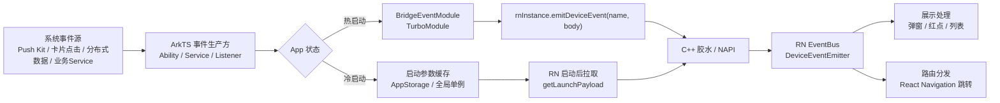
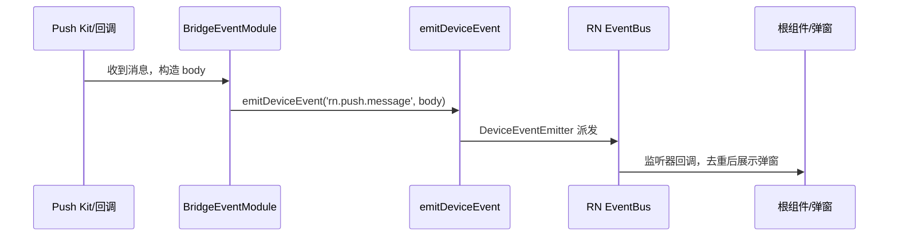
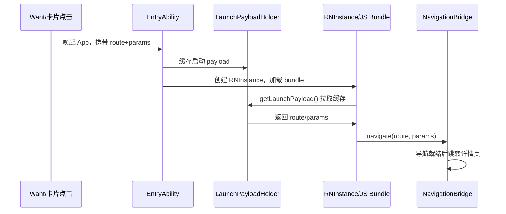

# RNOH 反向事件桥接：鸿蒙原生 → RN 消息下发与界面跳转 需求文档及实现方案

## 1. 文档信息

| 项 | 内容 |
| --- | --- |
| 项目 | RNOH（React Native OpenHarmony）混合工程 |
| 方向 | **反向桥接**：鸿蒙原生 / 系统事件 → RN 接收 → 界面展示或页面跳转 |
| 对比基线 | 正向桥接：RN 界面按钮触发 → TurboModule → ArkTS → 系统 Kit（已落地） |
| 适用版本 | @rnoh/react-native-openharmony 0.72+ 新架构（Fabric + TurboModule） |
| 交付物 | 事件通道设计、ArkTS/JS 代码骨架、路由跳转方案、异常与验收清单 |

## 2. 需求背景与目标

### 2.1 背景

正向桥接由 RN 界面按钮主动调用原生能力；但业务中大量场景是**原生侧先产生事件，再通知 RN**：推送消息到达、元服务卡片被点击、分布式数据变更、系统状态变化、后台任务结果回传等。RN 容器需要在不依赖用户点击 RN 按钮的前提下，被动接收这些事件并完成展示或跳转。

### 2.2 目标

1. 建立稳定的 **ArkTS → RN 单向事件通道**，支持消息体透传。
2. 支持两类落地动作：
   - **展示类**：推送消息、状态变更 → RN 弹窗 / 红点 / 列表刷新。
   - **跳转类**：携带路由与参数 → RN 导航到对应页面。
3. 覆盖 **冷启动（App 退出后被消息唤起）** 与 **热启动（App 已在前台/后台）** 两种状态。
4. 通道解耦：事件生产方（推送、卡片、系统监听）与 RN 消费方互不持有引用，可扩展新事件类型。

### 2.3 范围

| 在范围内 | 不在范围内 |
| --- | --- |
| 系统推送/消息到 RN 的事件下发、展示、跳转 | 推送服务本身的厂商通道接入细节（Push Kit 服务端配置） |
| RN 内部路由分发与参数透传 | ArkTS 原生页面之间的导航 |
| 监听生命周期、防重复、异常兜底 | 正向 JS → 原生方法调用（见正向桥接指南） |

## 3. 业务场景与用户故事

| 编号 | 场景 | 触发源 | RN 侧动作 | 启动状态 |
| --- | --- | --- | --- | --- |
| S1 | 推送消息到达，前台收到后弹窗展示 | Push Kit 消息回调 | 弹窗 / 通知栏内消息卡片展示 | 热启动（前台） |
| S2 | 点击通知栏/服务卡片，打开 App 直达详情页 | 卡片点击、Want 跳转 | 携带 `route + params` 跳转详情页 | 冷启动 / 后台回前台 |
| S3 | 分布式设备数据同步变更 | 分布式数据监听 | 列表刷新 / 红点提示 | 热启动 |
| S4 | 原生任务完成（如上传、登录态刷新） | 业务 Service | RN 刷新当前页状态 | 热启动 |
| S5 | 收到指定消息后做界面路由分发 | 任意原生事件源 | 按事件类型路由到对应 RN 页面 | 热启动 / 冷启动 |

## 4. 整体架构

### 4.1 反向链路



### 4.2 与正向桥接的关系

| 方向 | 触发方 | 机制 | 承载内容 |
| --- | --- | --- | --- |
| 正向（JS → 原生） | RN 按钮 / 业务代码 | TurboModule 方法调用，可带回调 | 主动请求能力（拍照、播报等） |
| **反向（原生 → JS）** | 鸿蒙系统 / 原生模块 | `emitDeviceEvent` 事件下发；冷启动走启动参数 | 被动通知、消息、路由指令 |

## 5. 通信机制选型

| 机制 | 适用 | 优点 | 限制 |
| --- | --- | --- | --- |
| `emitDeviceEvent`（DeviceEventEmitter） | 热启动下原生 → JS 实时通知 | RNOH 内置通道，无需自研；生产消费解耦 | 事件异步、不保证 JS 已渲染；需自行做就绪判断 |
| 启动参数 / initialProps + `getLaunchPayload` | 冷启动唤起时携带首屏数据/路由 | 解决 JS bundle 尚未加载、事件发了丢失的问题 | 仅启动时一次性读取 |
| ArkTS 进程内 `@ohos.events.emitter` | ArkTS 各模块间先汇聚 | 原生侧解耦 | 不能跨到 JS，最终仍需经 Bridge 模块下发 |

**选型结论**：原生侧先用 emitter 汇聚到统一 Bridge 模块；热启动经 `emitDeviceEvent` 下发；冷启动先缓存 payload，RN 就绪后由 JS 主动拉取或补发一次性事件。

## 6. 事件协议设计

### 6.1 通用事件体

```json
{
  "eventId": "uuid 或时间戳+序号",
  "eventName": "rn.push.message",
  "type": "message | route | state",
  "source": "push | card | distributed | service",
  "title": "标题（展示类）",
  "content": "内容（展示类）",
  "route": "OrderDetail",
  "params": { "id": "123", "from": "push" },
  "bizData": { },
  "timestamp": 1737600000000
}
```

### 6.2 预留事件名

| 事件名 | type | 含义 | RN 落地动作 |
| --- | --- | --- | --- |
| `rn.push.message` | message | 推送/消息展示 | 弹窗或写入消息列表 |
| `rn.route.navigate` | route | 路由跳转指令 | 导航至 `route`，透传 `params` |
| `rn.state.update` | state | 状态变更通知 | 刷新当前页 / 红点 |
| `rn.initial.launch` | route/message | 冷启动补发的首屏事件 | 启动后一次性消费 |

### 6.3 协议约束

- `eventId` 全局唯一，RN 侧据此去重，避免冷/热启动重复消费。
- `route` 必须在 RN 路由表注册表内；未注册时回退首页并埋点。
- `params` 仅传可序列化的纯对象（字符串、数字、布尔、嵌套对象/数组），不传函数、原生引用。

## 7. 详细实现方案

### 7.1 ArkTS 侧：统一事件桥接模块

模块职责：持有 `RNInstance` 引用，对外提供 `emitToRn`；供推送回调、卡片点击、Service 等原生方调用。

```ets
// harmony/entry/src/main/ets/turbomodule/BridgeEventModule.ets
import { AnyThreadTurboModule } from '@rnoh/react-native-openharmony';
import { TM } from '@rnoh/react-native-openharmony/generated/ts';
import { hilog } from '@kit.PerformanceAnalysisKit';

const DOMAIN: number = 0x0002;
const TAG: string = 'BridgeEventModule';

export const RN_EVENT_PUSH_MESSAGE = 'rn.push.message';
export const RN_EVENT_ROUTE = 'rn.route.navigate';
export const RN_EVENT_STATE = 'rn.state.update';
export const RN_EVENT_INITIAL = 'rn.initial.launch';

export interface RnEventBody {
  eventId: string;
  eventName: string;
  type: string;
  source: string;
  title?: string;
  content?: string;
  route?: string;
  params?: Record<string, Object>;
  bizData?: Record<string, Object>;
  timestamp: number;
}

export class BridgeEventModule extends AnyThreadTurboModule implements TM.BridgeEvent.Spec {
  /** 原生侧统一调用入口 */
  emitToRn(eventName: string, body: RnEventBody): void {
    if (!this.ctx || !this.ctx.rnInstance) {
      hilog.error(DOMAIN, TAG, 'rnInstance not ready, event cached: %{public}s', eventName);
      LaunchPayloadHolder.cache(eventName, body); // 未就绪时缓存，待就绪补发
      return;
    }
    try {
      this.ctx.rnInstance.emitDeviceEvent(eventName, body);
      hilog.info(DOMAIN, TAG, 'emitDeviceEvent ok: %{public}s', eventName);
    } catch (e) {
      hilog.error(DOMAIN, TAG, 'emit fail: %{public}s', e.message);
    }
  }
}
```

### 7.2 启动参数缓存（冷启动兜底）

```ets
// harmony/entry/src/main/ets/bridge/LaunchPayloadHolder.ets
import { RN_EVENT_INITIAL } from '../turbomodule/BridgeEventModule';

/** 冷启动 / RN 未就绪期间缓存事件，就绪后由 JS 拉取或模块补发 */
export class LaunchPayloadHolder {
  private static payload: Record<string, Object> | null = null;

  static cache(eventName: string, body: Record<string, Object>): void {
    LaunchPayloadHolder.payload = { eventName, ...body };
  }

  static take(): Record<string, Object> | null {
    const p = LaunchPayloadHolder.payload;
    LaunchPayloadHolder.payload = null;
    return p;
  }

  static peek(): Record<string, Object> | null {
    return LaunchPayloadHolder.payload;
  }
}
```

`EntryAbility` 解析 Want / 通知点击参数后写入缓存：

```ets
// EntryAbility.ets（片段）
onNewWant(want: Want): void {
  // 热启动：点击通知/卡片回到前台
  const body = this.parseWantToBody(want);
  if (body) {
    // 已注册的 BridgeEventModule 实例emit；未就绪则缓存
    BridgeHolder.getInstance()?.emitToRn(body.eventName, body);
  }
}

private parseWantToBody(want: Want): RnEventBody | null {
  const route: string | undefined = want.parameters?.['route'] as string;
  if (!route) return null;
  return {
    eventId: `${Date.now()}`,
    eventName: RN_EVENT_ROUTE,
    type: 'route',
    source: 'card',
    route,
    params: want.parameters as Record<string, Object>,
    timestamp: Date.now()
  };
}
```

### 7.3 模块映射与注册

```ets
// GeneratedPackage.ets
override getAnyThreadTurboModuleFactoryByNameMap():
  Map<string, (ctx: AnyThreadTurboModuleContext) => AnyThreadTurboModule | null> {
  const map = new Map();
  map.set(TM.BridgeEvent.NAME,
    (ctx) => new BridgeEventModule(ctx));
  return map;
}
```

> 与正向桥接一致：Spec 接口在 RN 工程声明、跑 codegen、`CMakeLists.txt` 编译 generated cpp、`PackageProvider.cpp` 注册 Package。反向事件本身不强制暴露 JS 方法，但模块必须注册后才能拿到 `ctx.rnInstance`。

### 7.4 RN 侧：统一事件总线封装

```ts
// src/bridge/RNEventBus.ts
import { DeviceEventEmitter } from 'react-native';

export interface RoutePayload {
  route: string;
  params?: Record<string, any>;
}

export interface MessagePayload {
  title?: string;
  content?: string;
  bizData?: Record<string, any>;
}

type Listener<T> = (payload: T) => void;

function subscribe<T>(eventName: string, listener: Listener<T>): () => void {
  const sub = DeviceEventEmitter.addListener(eventName, (payload: T) => listener(payload));
  return () => sub.remove();
}

export const onPushMessage = (cb: Listener<MessagePayload & RoutePayload>) =>
  subscribe('rn.push.message', cb);

export const onRouteNavigate = (cb: Listener<RoutePayload>) =>
  subscribe('rn.route.navigate', cb);

export const onStateUpdate = (cb: Listener<Record<string, any>>) =>
  subscribe('rn.state.update', cb);

export const onInitialLaunch = (cb: Listener<RoutePayload & MessagePayload>) =>
  subscribe('rn.initial.launch', cb);
```

### 7.5 路由分发（React Navigation 示例）

维护导航器引用，事件到达时判断导航是否就绪；未就绪则进入待跳转队列，首屏渲染完成后消费。

```ts
// src/bridge/NavigationBridge.ts
import { NavigationContainer, useNavigation } from '@react-navigation/native';

let navigationRef: any = null;
let pendingRoute: { route: string; params?: Record<string, any> } | null = null;

export function setNavigationRef(ref: any): void {
  navigationRef = ref;
  if (pendingRoute && ref) {
    navigate(pendingRoute.route, pendingRoute.params);
    pendingRoute = null;
  }
}

/** 路由白名单：未注册页面回退首页 */
const ROUTE_WHITELIST = ['Home', 'OrderDetail', 'MessageList', 'Setting'];

export function navigate(route: string, params?: Record<string, any>): boolean {
  if (!navigationRef || !navigationRef.isReady()) {
    pendingRoute = { route, params };
    return false;
  }
  if (!ROUTE_WHITELIST.includes(route)) {
    route = 'Home';
  }
  navigationRef.navigate(route, params);
  return true;
}
```

在根容器绑定：

```tsx
// App.tsx（片段）
import { NavigationContainer } from '@react-navigation/native';
import { setNavigationRef } from './src/bridge/NavigationBridge';

<NavigationContainer ref={(ref) => setNavigationRef(ref)}>
  {/* StackNavigator */}
</NavigationContainer>
```

### 7.6 事件订阅与消费（根组件统一挂载）

```tsx
// src/bridge/useBridgeEvents.ts
import { useEffect, useRef } from 'react';
import { onPushMessage, onRouteNavigate, onInitialLaunch } from './RNEventBus';
import { navigate } from './NavigationBridge';

const consumedEventIds = new Set<string>();

function dedupe(eventId?: string): boolean {
  if (!eventId) return false;
  if (consumedEventIds.has(eventId)) return true;
  consumedEventIds.add(eventId);
  return false;
}

export function useBridgeEvents(): void {
  const routeUnsub = useRef<() => void>();
  const messageUnsub = useRef<() => void>();
  const initialUnsub = useRef<() => void>();

  useEffect(() => {
    // 跳转类
    routeUnsub.current = onRouteNavigate((payload) => {
      if (dedupe(payload.eventId)) return;
      navigate(payload.route, payload.params);
    });

    // 展示类：按业务弹弹窗 / 写全局消息状态
    messageUnsub.current = onPushMessage((payload) => {
      if (dedupe(payload.eventId)) return;
      // 例如：通知全局弹窗组件展示 payload.title / payload.content
      // MessageStore.show({ title: payload.title, content: payload.content });
    });

    // 冷启动补发：首屏就绪后一次性消费
    initialUnsub.current = onInitialLaunch((payload) => {
      if (dedupe(payload.eventId)) return;
      if (payload.route) navigate(payload.route, payload.params);
      // 其余展示类数据写入首屏状态
    });

    return () => {
      routeUnsub.current?.();
      messageUnsub.current?.();
      initialUnsub.current?.();
    };
  }, []);
}
```

根组件调用 `useBridgeEvents()` 完成全局订阅；页面内若只需局部监听，同样通过 `onXxx` 订阅并在 `useEffect` 返回值中 `remove`。

### 7.7 冷启动数据拉取

JS 启动后先主动拉一次原生缓存的启动参数（TurboModule 暴露一个同步/异步读取方法），避免事件在 bundle 加载前丢失：

```ts
// src/specs/NativeBridgeLauncher.ts
import type { TurboModule } from 'react-native';
import { TurboModuleRegistry } from 'react-native';

export interface Spec extends TurboModule {
  getLaunchPayload(): Record<string, any> | null;
}

export default TurboModuleRegistry.getEnforcing<Spec>('BridgeLauncher');
```

```ts
// 启动入口
useEffect(() => {
  const payload = NativeBridgeLauncher.getLaunchPayload();
  if (payload) {
    // 走与 onInitialLaunch 相同的消费逻辑
  }
}, []);
```

## 8. 关键时序

### 8.1 热启动：推送消息弹窗



### 8.2 冷启动：点击卡片直达详情



## 9. 边界与异常处理

| 场景 | 处理策略 |
| --- | --- |
| RN 未就绪时收到事件 | ArkTS 侧缓存到 `LaunchPayloadHolder`，就绪后补发；JS 启动主动拉取兜底 |
| 冷/热启动重复消费同一事件 | `eventId` 去重集合，命中即丢弃 |
| 跳转目标页面未注册 | 回退 `Home`，上报埋点，不崩溃 |
| 导航器尚未挂载 | 进入 `pendingRoute` 队列，`navigationRef` 就绪后消费 |
| 事件体不可序列化 / 缺字段 | ArkTS 侧构造时校验；JS 侧判空，缺 `route`/`content` 时忽略 |
| 监听未注销导致泄漏 | 所有订阅在 `useEffect` cleanup 中 `remove`；模块销毁时清定时器/引用 |
| 高频事件冲卡 JS 线程 | 业务侧节流/合帧；UI 更新放 `requestAnimationFrame`；耗时处理放子线程 |
| 未登录收到需鉴权的跳转 | 跳转拦截器先判断登录态，未登录转登录页，登录成功后再回跳原目标 |

## 10. 线程与性能规范

1. Bridge 模块继承 `AnyThreadTurboModule`，事件发送不在 UI 主线程做耗时处理；重活经 TaskPool/Worker 分发。
2. 禁止在事件回调里同步做大数据解析、加解密、图片处理；先落数据再异步渲染。
3. 高频状态类事件（播放进度、音量等）需节流，避免 JS 线程频繁 setState 造成只收前几条、后续丢失甚至闪退。
4. 监听器、定时器在页面/模块销毁时必须释放，防止内存堆积。

## 11. 目录结构建议

```
harmony/entry/src/main/ets/
├── turbomodule/
│   ├── BridgeEventModule.ets      # 反向事件下发模块
│   └── BridgeLauncherModule.ets   # 冷启动 payload 读取
├── bridge/
│   └── LaunchPayloadHolder.ets    # 未就绪事件缓存
├── GeneratedPackage.ets
└── RNPackagesFactory.ets

src/
├── specs/
│   └── NativeBridgeLauncher.ts
├── bridge/
│   ├── RNEventBus.ts              # 事件订阅封装
│   ├── NavigationBridge.ts        # 导航引用与跳转队列
│   └── useBridgeEvents.ts         # 全局事件消费 Hook
└── pages/                         # RN 路由页面
```

## 12. 验收标准

| 编号 | 验收项 | 预期 |
| --- | --- | --- |
| AC1 | 热启动下原生发送 `rn.push.message` | RN 监听到并弹窗展示标题/内容 |
| AC2 | 热启动下原生发送 `rn.route.navigate` | RN 跳转至指定页面且参数正确透传 |
| AC3 | 杀掉 App 后点击卡片唤起 | 冷启动直达目标详情页，参数不丢失 |
| AC4 | 同一事件重复下发 | 仅消费一次，无重复弹窗/重复跳转 |
| AC5 | 跳转未注册路由 | 回退首页，无白屏崩溃 |
| AC6 | 页面退出后再进入 | 旧监听已注销，无重复回调、无内存增长 |
| AC7 | 高频事件连续下发 | JS 线程不卡顿，事件不大面积丢失 |
| AC8 | 未登录收到鉴权页面跳转 | 拦截转登录页，登录后回跳 |

## 13. 常见问题排查

| 现象 | 排查方向 |
| --- | --- |
| JS 监听不到事件 | ① `ctx.rnInstance` 是否为空；② 模块是否注册进映射表；③ 事件名两侧是否一致；④ 是否 codegen 生成胶水代码 |
| 冷启动事件丢失 | 是否在 bundle 加载前发送；检查 `LaunchPayloadHolder` 缓存与 `getLaunchPayload` 拉取链路 |
| 只收到前几条后断流 | JS 线程被高频 setState 卡住；检查节流、监听注销、UI 更新合帧与内存占用 |
| 跳转无效 | 导航器是否 `isReady`；路由名是否在白名单；参数是否可序列化 |
| 页面退出后重复回调 | cleanup 中是否调用 `subscription.remove()` |

## 14. 待确认事项（落地前需对齐）

1. 推送通道：Push Kit 回调落在哪个 Ability/Extension，事件由谁统一汇聚到 Bridge 模块。
2. RN 路由方案：React Navigation 还是自研路由；页面注册表清单。
3. 消息展示形态：全局弹窗、站内信列表，还是红点角标。
4. 登录态拦截规则与未登录回跳策略。
5. 事件持久化：离线期间到达的消息是否需要落库、进入 RN 后补发。

> （注：部分内容由豆包 AI 生成）